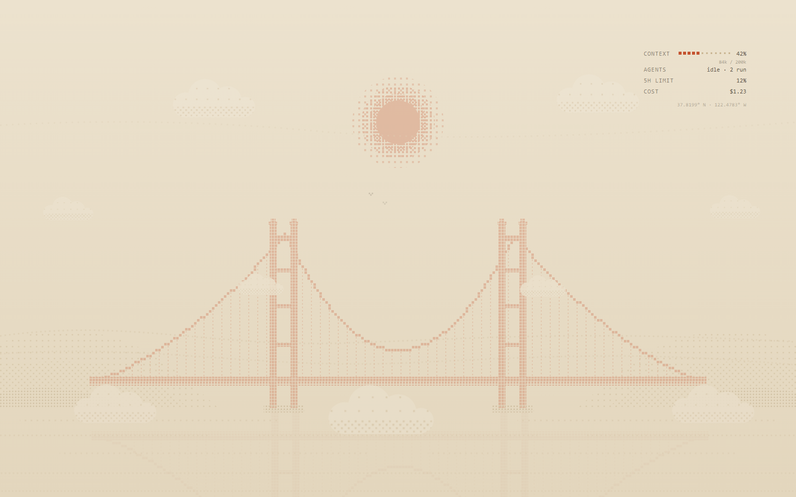
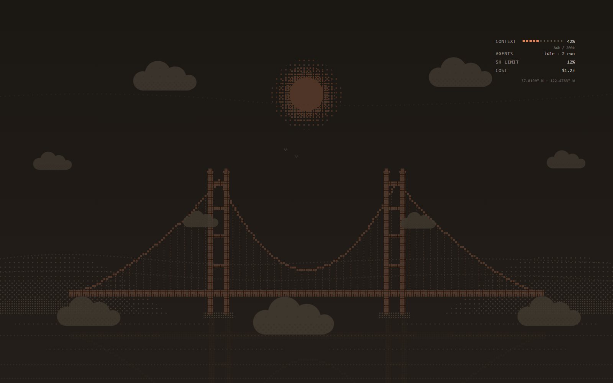

# Claude Code Themes

I built this repository to share Golden Gate Dither, a Claude Code mod that adds an animated, dithered Golden Gate Bridge scene and a matching color palette to the Code tab.

## Install

In a local session in Claude Desktop's Code tab, run:

```text
/plugin marketplace add timothyouu/claude-code-themes
/plugin install golden-gate-dither@claude-code-themes
```

Then open a new Code session and send a message. The backdrop appears after the session's first message.

This mod needs Claude Code 2.1.325 or later in the Code tab. I tested it on Windows with Claude Desktop 5.11492.5.0 and Claude Code 2.1.325. I have not verified the mobile app or other platforms.

## Golden Gate Dither





These are scene previews rendered with sample readout values, not screenshots of Claude Desktop. To view the animation, clone or download the repository and open [assets/preview.html](assets/preview.html) in a browser.

See [the theme README](themes/golden-gate-dither/README.md) for commands, behavior, troubleshooting, and local development. See [the build story](docs/BUILD_STORY.md) for how I made and debugged it.

## Develop

From the repository root, start Claude Code with the plugin directory:

```bash
claude --plugin-dir ./themes/golden-gate-dither
```

After editing files, run `/reload-plugins` in the affected Code session. If Claude Code reports that one copy of `golden-gate-dither` did not load because another copy has the same name, check the loaded source in `/plugin` and edit that copy, or remove the duplicate before testing.

Validate the plugin from the repository root:

```bash
claude plugin validate themes/golden-gate-dither
node --test tests/*.test.cjs
```

The JavaScript checks need Node.js 22.14 or later.

## Credits

I used [ishuagrawal/claude-code-themes](https://github.com/ishuagrawal/claude-code-themes) as a reference for repository packaging and setup documentation. I followed [Anthropic's backdrop documentation](https://code.claude.com/docs/en/plugins/mods/interface#put-a-backdrop-behind-the-conversation) and used the `makeColors` helper supplied with Claude Code's mod-authoring tooling, as described in [Anthropic's custom color mod guide](https://code.claude.com/docs/en/plugins/mods/interface#write-a-colors-mod-yourself). I also looked at [Anthropic's theme-examples plugin](https://github.com/anthropics/claude-plugins-official/tree/main/plugins/theme-examples) as a published backdrop example.

## License

This repository is licensed under [Apache-2.0](LICENSE). See [NOTICE](NOTICE) for third-party notices.
