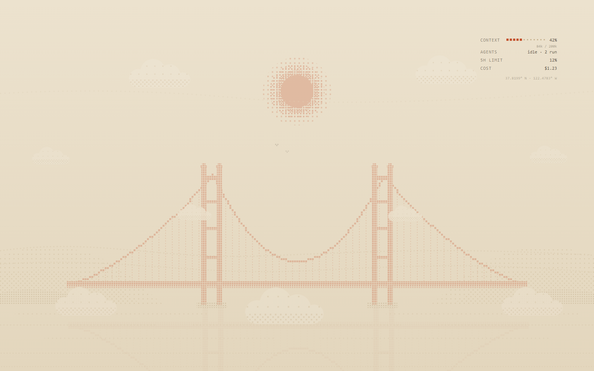
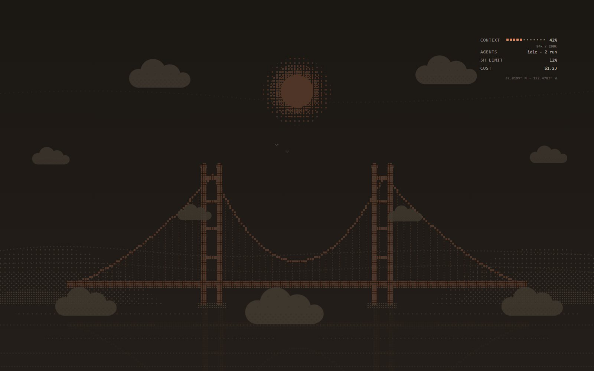

# Golden Gate Dither

I built Golden Gate Dither for Claude Code's Code tab. It draws the bridge, low shorelines, clouds, gulls, and water as a slowly moving SVG illustration on a six-pixel grid, with matching light and dark colors.

## Install

In a local Claude Desktop Code session, add the marketplace and install the plugin:

```text
/plugin marketplace add timothyouu/claude-code-themes
/plugin install golden-gate-dither@claude-code-themes
```

Open a new Code session and send a message. The backdrop appears after the first message. Claude Code 2.1.325 or later is required. I tested on Windows with Claude Desktop 5.11492.5.0 and Claude Code 2.1.325. Mobile and other platforms are not verified.

## Scene previews

These previews use sample values for the small session readout. They are generated scene previews, not screenshots of Claude Desktop.





To view the animation, clone or download the repository and open [assets/preview.html](../../assets/preview.html) in a browser.

## Commands

Run these commands in the Code session where the theme is installed:

| Command | What it does |
| --- | --- |
| `/golden-gate off` | Turns the theme off and keeps it off in later sessions. |
| `/golden-gate on` | Turns the theme back on, using the current session's appearance choice. A new session starts in auto. |
| `/golden-gate auto` | Uses the animated scene and follows Claude Desktop's Light, Dark, or System appearance. |
| `/golden-gate light` | Uses the animated scene with light colors for this session. |
| `/golden-gate dark` | Uses the animated scene with dark colors for this session. |
| `/golden-gate scene` | Returns to the animated scene with the current session's appearance choice. |
| `/golden-gate image` | Shows the older still JPEG in light appearance. It does not adapt like the animated scene. |
| `/golden-gate test` | Shows a bold test pattern to check whether SVG backdrops render. |
| `/golden-gate status` | Reports the selected appearance, active backdrop, and render diagnostics. |

The on/off choice is saved between sessions. Appearance selection lasts for the current session, and each new session starts in auto. Auto is the default. The animated SVG uses the app's light or dark color scheme directly, while `light` and `dark` explicitly override it. The backdrop API does not expose the effective app appearance to the hook, so automatic scene colors are selected inside the SVG.

The small readout can show context use, token and window counts, active and total agent calls, the five-hour usage limit, and session cost when Claude Code reports them. It reads session data locally. The mod makes no direct network or analytics calls.

## Troubleshooting

- **No scene appears:** This theme is verified in Claude Desktop's Code tab on Windows, not on mobile. Terminal sessions do not draw backdrops. Run `/golden-gate status`, confirm the plugin is loaded with `/plugin`, and start a new Code session after installation.
- **The background is covered or looks absent on Windows:** This mod sets the backdrop glass to `false`, which avoids the opaque veil seen on my Windows setup with transparency disabled. Update to the current plugin copy and reload it with `/reload-plugins`.
- **Text and art colors do not match:** Run `/golden-gate auto` and check Claude Desktop's Appearance setting under Light, Dark, or System. Use `/golden-gate light` or `/golden-gate dark` only when you want to pin one appearance for the current session.
- **A code edit does not show up:** Run `/reload-plugins` in the Code session. If an installed copy and a development copy share the plugin name, open `/plugin` and edit the copy Claude Code actually loaded, or remove the duplicate before testing.
- **The scene is still:** `/golden-gate image` is a static JPEG. Use `/golden-gate scene` for the animated illustration and `/golden-gate test` to isolate SVG rendering.

A session can have one active theme at a time. Setting this theme replaces the session's current theme colors and backdrop.

## Develop

From the repository root, load this plugin for a local session:

```bash
claude --plugin-dir ./themes/golden-gate-dither
```

After edits, use `/reload-plugins` in that session. To check the package and the repository's JavaScript tests, run:

```bash
claude plugin validate themes/golden-gate-dither
node --test tests/*.test.cjs
```

The JavaScript checks need Node.js 22.14 or later. See the [repository README](../../README.md) for setup and the [build story](../../docs/BUILD_STORY.md) for implementation notes.

This theme is licensed under [Apache-2.0](LICENSE).
